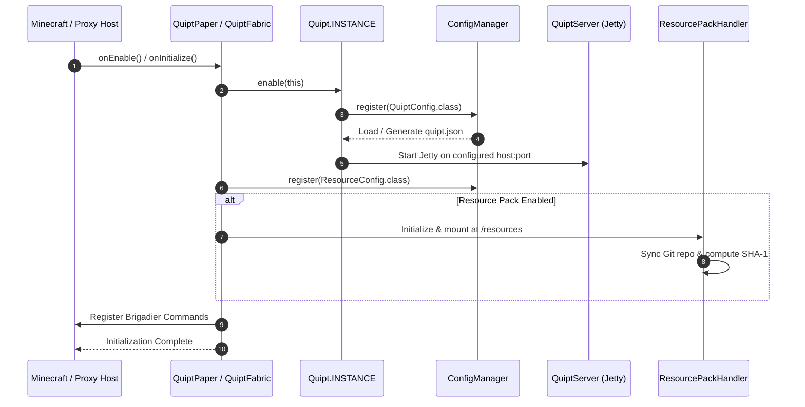
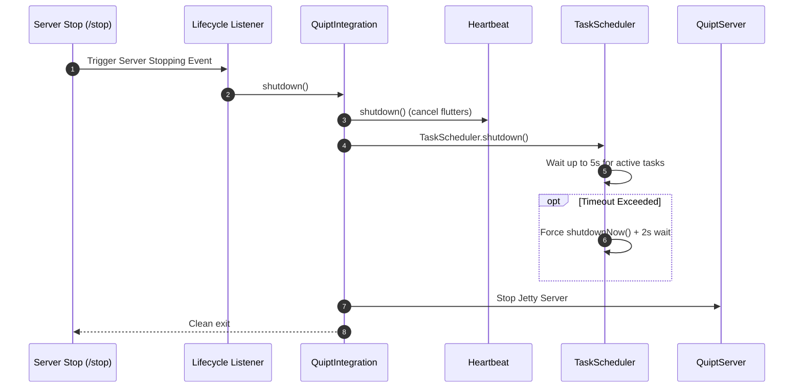

# QUIPT Architecture

QUIPT is designed following a **hexagonal, modular architecture** where business logic, background services, network utilities, and data models remain completely decoupled from platform-specific APIs.

```mermaid
flowchart TD
    subgraph Core Layer ["quipt-core (Platform Agnostic)"]
        QI[QuiptIntegration]
        QServer[QuiptServer (Jetty)]
        CM[ConfigManager]
        EB[EventHandler]
        HB[Heartbeat & TaskScheduler]
        REG[Registries & Registry]
        WM[WebhookManager]
        CH[CharityManager]
    end

    subgraph Common Layer ["quipt-common (Minecraft Abstractions)"]
        MI[MinecraftIntegration]
        CMD[Brigadier Command Abstraction]
        RPH[ResourcePackHandler]
        MU[MessageUtils & Placeholders]
        PTY[Party Management]
    end

    subgraph Platform Layer ["Platform Adapters"]
        Paper[quipt-paper<br/>Paper / Bukkit Plugin]
        Fabric[quipt-fabric<br/>Fabric Server & Client Mod]
        Velocity[quipt-velocity<br/>Velocity Proxy Plugin]
        Bot[quipt-bot<br/>Standalone / Embedded Discord Bot]
    end

    Core Layer --> Common Layer
    Common Layer --> Paper
    Common Layer --> Fabric
    Common Layer --> Velocity
    Core Layer --> Bot
```

---

## Architectural Principles

1. **Strict Separation of Concerns**:
   - `core` contains zero Minecraft or Bukkit/Fabric dependencies. It runs on pure standard Java 21/25 with minimal third-party libraries (Jetty, Jackson, org.json, SLF4J).
   - `common` defines common interfaces and models for Minecraft (`MinecraftPlayer`, `MinecraftIntegration`, `CommandBuilder`, `ResourcePackHandler`) without binding to a concrete server implementation.
   - `paper`, `fabric`, and `velocity` act strictly as platform adapters, translating native platform events, commands, and lifecycles into QUIPT abstractions.

2. **Hierarchical Integration Tree**:
   - Every module, sub-integration, and bot plugin is a subclass of `QuiptIntegration`.
   - The root instance `Quipt.INSTANCE` maintains an internal `Registry<QuiptIntegration>` containing all active integrations in the running JVM.
   - This enables centralized logging, common config directories, shared scheduler threads, and synchronized shutdown sequences.

3. **Graceful Asynchronous Lifecycles**:
   - Long-running background operations (heartbeats, periodic polling, HTTP request handling, executor services) are managed centrally.
   - Shutdown hooks guarantee that executor queues are drained, HTTP endpoints are stopped, and active threads are cleanly terminated without leaving zombie processes.

---

## Detailed Module Responsibilities

### 1. `quipt-core`
The bedrock of the entire framework.
- **`QuiptIntegration`**: Abstract base class providing structured logging (`Logger`), dedicated data directories (`File folder()`), config manager binding, and lifecycle states (`enable()`, `shutdown()`).
- **`Quipt` (Singleton)**: Top-level integration maintaining global registries, the embedded `QuiptServer`, the event dispatcher `EventHandler`, the `WebhookManager`, and `CharityManager`.
- **`QuiptServer` & `QuiptHandler`**: Lightweight embedded Jetty 11 web server hosting servlets, webhooks, and REST endpoints.
- **`ConfigManager` & `Config`**: Annotation-driven configuration framework supporting automatic schema creation, reflection mapping, and JSON/YAML/QPT serializers.
- **`Heartbeat` & `Flutter`**: Non-blocking periodic task runner designed for continuous data polling and state checks.
- **`TaskScheduler`**: Centralized `ScheduledExecutorService` wrapper with thread safety and graceful termination timeouts.
- **`EventHandler`**: Event dispatching system with cancellable events and reflection-based listener routing.
- **`Registries`**: Generalized dictionary registry system for dynamic lookup and extension points.

### 2. `quipt-common`
Shared abstractions for all Minecraft platforms.
- **`MinecraftIntegration<T, K>`**: Generic interface abstracting server plugins, identifiers/keys, and platform resources.
- **`CommandBuilder<S>` & `CommonCommand<S, P>`**: Brigadier-based command builder pattern providing fluent syntax definitions across Paper, Fabric, and Velocity.
- **`ResourcePackHandler`**: In-memory and on-disk Git repository manager (via JGit) that clones, pulls, hashes, compresses, and distributes Minecraft resource packs over HTTP.
- **`MessageUtils`**: Adventure component builder, mini-message string parser, token replacement, and persistence in `message.json`.
- **`PartyConfig` & `Party`**: Cross-platform player party management with automatic JSON persistence.

### 3. `quipt-paper`
Paper / Purpur / Bukkit server plugin adapter.
- **`QuiptPaper` & `QuiptPlugin`**: Entry points implementing `JavaPlugin`, registering commands (`/quipt`, `/webhook`, `/party`, `/sudo`), mounting HTTP routes, and starting the optional Discord bot.
- **`PaperPlayers` & `PaperPlayer`**: Player wrapper implementing session tracking, custom player settings, and UUID mapping.
- **`PaperCommandExecutor`**: Bridges Brigadier argument trees to the Bukkit command subsystem.
- **`VoidChunkGenerator`**: High-performance empty world generator for custom minigame / lobby servers.

### 4. `quipt-fabric`
Fabric mod adapter for server and client.
- **`QuiptFabric` & `QuiptMod`**: Mod entry points integrating with Fabric Loader, registering lifecycle listeners for clean shutdown (`FabricLifecycleListener`).
- **`FabricCommandExecutor`**: Bridges Brigadier argument trees directly into Minecraft's native server command dispatcher.
- **Block & Item Framework**: Extensible base classes (`QuiptBlock`, `QuiptBlockWithEntity`, `QuiptItem`, `FoodSettings`) with data-generation support.
- **Networking & Particles**: Custom packet handlers (`PluginMessagePacket`, `PluginMessageEvent`) and particle effect systems.

### 5. `quipt-velocity`
Velocity proxy plugin adapter.
- **`QuiptVelocity` & `QuiptProxy`**: Velocity plugin binding allowing network-level commands (`/vquipt`, `/vwebhook`) and cross-server communication coordination.

### 6. `quipt-bot`
Dedicated Discord bot module.
- **`QuiptBot` & `BotModule`**: JDA-backed Discord client lifecycle manager with automatic token verification and guild member caching.
- **`QDA`**: Clean abstraction over Discord entities (`QuiptGuild`, `QuiptTextChannel`, `QuiptMessage`, `QuiptUser`).
- **`BotPluginLoader` & `BotPlugin`**: Dynamic JAR classloader allowing developers to drop standalone plugin JARs into `bot_plugins/` at runtime without restarting the main application.

---

## Execution & Initialization Flow

When a host (e.g. Paper or Fabric) boots up with QUIPT:



---

## Safe Shutdown Flow

Graceful termination is essential to avoid corrupted JSON configs or hanging executor threads during server restart:


