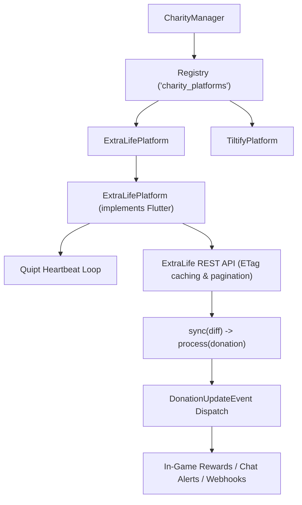

# Charity Integration Engine

QUIPT provides an automated **Charity Tracking Framework** designed for community charity livestreams, fundraising events, and in-game reward triggers. It features out-of-the-box support for **ExtraLife** and **Tiltify**.

## System Architecture



---

## 1. ExtraLife Integration (`ExtraLifePlatform`)

The ExtraLife integration periodically polls the official ExtraLife API for team donations, efficiently handling ETags, batching, and duplicate prevention.

### Configuration (`donations.json`)

```json title="quipt/data/donations.json"
{
  "api_endpoint": "https://www.extra-life.org/api/",
  "team_id": "65432",
  "seconds_per_check": 30,
  "donations": 142,
  "total": 3550.00,
  "etag": "W/\"3a7b-xyz123\"",
  "processed": {
    "DONATION-ID-001": { "amount": 25.0, "donor": "Steve" }
  }
}
```

### Key Technical Features:
- **ETag Caching**: Only queries the full donation payload when the team's `etag` header changes (HTTP 304 skipping).
- **Pagination Protection**: Automatically caps processing at `MAX_LIMIT = 100` donations per cycle using `offset` tracking to prevent CPU spikes or API rate-limiting during large donation bursts.
- **Deduplication**: Maintains a hash map of processed donation IDs in `processed`.

---

## 2. Tiltify Integration (`TiltifyPlatform`)

The Tiltify integration supports OAuth2 token exchange and the Tiltify v5 API for campaigns and teams.

### Configuration (`tiltify_config.json`)

```json title="quipt/data/tiltify_config.json"
{
  "api_key": "your_api_key",
  "tiltify_base_url": "https://v5api.tiltify.com",
  "oauth_url": "https://v5api.tiltify.com/oauth/token",
  "client_id": "your_client_id",
  "client_key": "your_client_secret"
}
```

---

## Hooking into Donation Events

When new donations are verified, QUIPT fires a `DonationUpdateEvent`:

```java
import live.qsmc.quipt.core.Quipt;
import live.qsmc.quipt.core.charity.el.ExtraLifeDonation;
import live.qsmc.quipt.core.charity.event.DonationUpdateEvent;
import live.qsmc.quipt.core.charity.event.DonationUpdateListener;

public class MyDonationRewardHandler implements DonationUpdateListener<ExtraLifeDonation> {

    @Override
    public void onEvent(DonationUpdateEvent<ExtraLifeDonation> event) {
        for (ProcessResult<ExtraLifeDonation> result : event.data().results()) {
            if (result.type() == ProcessResult.Type.SUCCESS) {
                ExtraLifeDonation donation = result.donation();
                
                // Broadcast in-game
                System.out.println("Received $" + donation.amount + " from " + donation.donorName);
                
                // Spawn celebratory effects or grant rewards
                grantDonorPerks(donation.donorName, donation.amount);
            }
        }
    }
}
```

### Registering the Listener

```java
Quipt.INSTANCE.events().register(new MyDonationRewardHandler());
```
