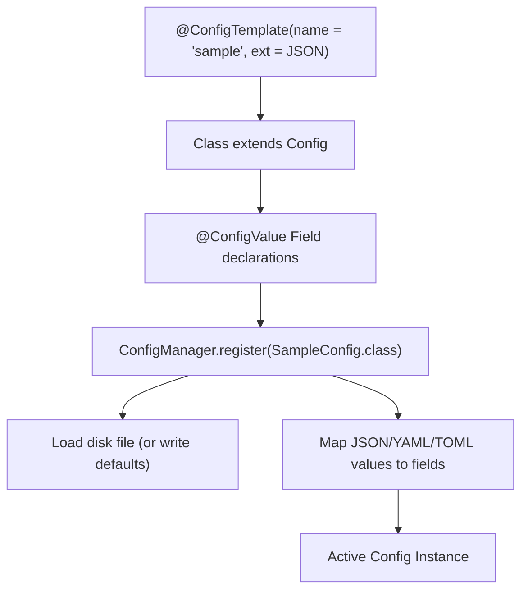

# Configuration Engine

QUIPT includes a **reflection-driven, type-safe configuration system** centered around `ConfigManager` and `ConfigTemplate`. It automates file creation, field deserialization, default value population, and persistent disk writes without boilerplate mapping code.

## Core Concepts



### Supported File Formats (`ConfigTemplate.Extension`)
- **`JSON`** (`.json`)
- **`YAML`** (`.yml`)
- **`TOML`** (`.toml`)
- **`QPT`** (`.qpt` - QUIPT property format)
- **`XML`** (`.xml`)

---

## Defining a Custom Configuration

To create a configuration file, extend `live.qsmc.quipt.core.config.Config` and annotate the class with `@ConfigTemplate`:

```java
package com.example.plugin.config;

import live.qsmc.quipt.core.QuiptIntegration;
import live.qsmc.quipt.core.config.Config;
import live.qsmc.quipt.core.config.ConfigTemplate;
import live.qsmc.quipt.core.config.ConfigValue;
import java.io.File;

@ConfigTemplate(name = "server_settings", ext = ConfigTemplate.Extension.JSON)
public class ServerSettingsConfig extends Config {

    @ConfigValue
    public String server_name = "My Minecraft Network";

    @ConfigValue
    public int max_players_per_party = 8;

    @ConfigValue
    public boolean maintenance_mode = false;

    public ServerSettingsConfig(File file, String name, ConfigTemplate.Extension extension, QuiptIntegration integration) {
        super(file, name, extension, integration);
    }
}
```

---

## Registering and Loading Configs

Register your configuration class with your integration's `ConfigManager`:

```java
// Inside your QuiptIntegration enable() method:
ServerSettingsConfig config = configs().register(ServerSettingsConfig.class);

// Access values with direct field access:
if (config.maintenance_mode) {
    logger().warn("Security", "Server is currently in maintenance mode!");
}
```

### Saving Modifications at Runtime

```java
config.maintenance_mode = true;
config.save(); // Automatically serializes all fields back to disk
```

---

## Complex Objects & Polymorphic Collections

The configuration system supports nested objects (`ConfigObject`) and key-value maps (`ConfigMap<T>`).

### Example: Nested `ConfigObject`

```java
public static class DatabaseCredentials extends ConfigObject {
    public String host = "localhost";
    public int port = 3306;
    public String database = "quipt";

    public DatabaseCredentials(QuiptIntegration integration) {
        super(integration);
    }
}

@ConfigTemplate(name = "database", ext = ConfigTemplate.Extension.JSON)
public class DatabaseConfig extends Config {
    @ConfigValue
    public DatabaseCredentials credentials;

    public DatabaseConfig(File file, String name, ConfigTemplate.Extension extension, QuiptIntegration integration) {
        super(file, name, extension, integration);
        this.credentials = new DatabaseCredentials(integration);
    }
}
```

### Dynamic Maps (`ConfigMap`)

`ConfigMap<T>` allows storing dynamic collections of objects indexed by an ID:

```java
@ConfigTemplate(name = "warps", ext = ConfigTemplate.Extension.JSON)
public class WarpConfig extends Config {
    @ConfigValue
    public ConfigMap<WarpLocation> warps;

    public WarpConfig(File file, String name, ConfigTemplate.Extension extension, QuiptIntegration integration) {
        super(file, name, extension, integration);
        this.warps = new ConfigMap<>(integration);
    }
}
```

---

## Custom Factories (`GenericFactory`)

For nested complex classes, register a factory so `ConfigManager` can instantiate instances during deserialization:

```java
configs().factory(new GenericFactory<>(MyCustomData.class));
```
