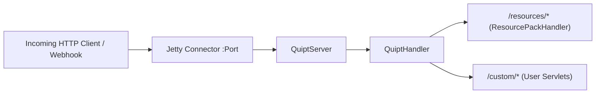

# Embedded Jetty Web Server

QUIPT embeds a lightweight, high-performance **Eclipse Jetty 11** HTTP/HTTPS server (`QuiptServer`) directly within the host process. This eliminates the need for external web servers when serving resource packs, handling external API webhooks, or providing status endpoints.

## Server Architecture

`QuiptServer` extends `org.eclipse.jetty.server.Server` and encapsulates route dispatching through `QuiptHandler`.



---

## Configuration (`quipt.json`)

The embedded server is configured via `QuiptConfig.WebData` in `quipt/data/quipt.json`:

```json title="quipt/data/quipt.json"
{
  "webData": {
    "protocol": "HTTP",
    "host": "0.0.0.0",
    "port": 5252
  },
  "access_token": "secret_token_here"
}
```

### Configuration Fields

| Field | Type | Default | Description |
| :--- | :--- | :--- | :--- |
| `protocol` | String | `HTTP` | Protocol string: `HTTP` or `HTTPS`. |
| `host` | String | `127.0.0.1` | Binding IP address (`0.0.0.0` to listen on all network interfaces). |
| `port` | Integer | `5252` | Listening TCP port number. |
| `access_token` | String | `""` | Optional master token for authenticated endpoints. |

---

## Registering Custom Handlers & Servlets

Developers can mount custom endpoints onto the server by extending `QuiptServlet` or `jakarta.servlet.http.HttpServlet`.

### Example: Custom REST Endpoint

```java
import jakarta.servlet.http.HttpServletRequest;
import jakarta.servlet.http.HttpServletResponse;
import live.qsmc.quipt.core.Quipt;
import live.qsmc.quipt.core.server.QuiptServlet;
import java.io.IOException;

public class PingHandler extends QuiptServlet {

    public PingHandler() {
        super(Quipt.INSTANCE.server());
    }

    @Override
    protected void doGet(HttpServletRequest req, HttpServletResponse resp) throws IOException {
        resp.setContentType("application/json");
        resp.setStatus(HttpServletResponse.SC_OK);
        resp.getWriter().println("{\"status\":\"ok\",\"timestamp\":" + System.currentTimeMillis() + "}");
    }
}
```

### Mounting the Route

```java
PingHandler pingHandler = new PingHandler();

// Mount on "/ping" and all sub-paths
Quipt.INSTANCE.server().handler().handle("ping", pingHandler, "ping/*");
```

---

## Built-in Endpoints

| Route | Handler Class | Description |
| :--- | :--- | :--- |
| `/resources` | `ResourcePackHandler` | Serves the generated resource pack `pack.zip`. |
| `/resources/update` | `ResourcePackHandler` | Webhook endpoint invoked by GitHub/GitLab on push events to trigger instant resource pack sync. |

---

## Production Deployment & Reverse Proxies

For public servers, it is recommended to bind `host` to `127.0.0.1` and place a reverse proxy like **Nginx** or **Caddy** in front:

### Nginx Example Configuration

```nginx
server {
    listen 80;
    server_name pack.example.com;

    location / {
        proxy_pass http://127.0.0.1:5252;
        proxy_set_header Host $host;
        proxy_set_header X-Real-IP $remote_addr;
        proxy_set_header X-Forwarded-For $proxy_add_x_forwarded_for;
        proxy_set_header X-Forwarded-Proto $scheme;
    }
}
```
