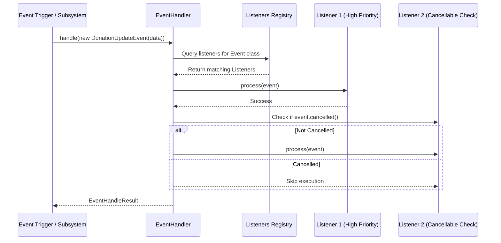

# Asynchronous Event Bus

QUIPT provides an **in-process event bus** (`EventHandler`) that allows modules, integrations, and plugins to communicate asynchronously without tight coupling.

## Event System Architecture



---

## Defining an Event

Events extend `live.qsmc.quipt.core.events.Event<D>` where `D` represents the contextual payload (`EventData`).

### Example: Custom Event

```java
package com.example.events;

import live.qsmc.quipt.core.QuiptIntegration;
import live.qsmc.quipt.core.events.Event;
import live.qsmc.quipt.core.events.EventData;

public class PlayerRankChangeEvent extends Event<PlayerRankChangeEvent.Data> implements Event.Cancellable {

    private boolean cancelled = false;

    public PlayerRankChangeEvent(QuiptIntegration integration, Data data) {
        super(integration, data);
    }

    @Override
    public boolean cancelled() {
        return cancelled;
    }

    @Override
    public void cancel(boolean cancel) {
        this.cancelled = cancel;
    }

    public static class Data implements EventData {
        public final String playerUuid;
        public final String oldRank;
        public final String newRank;

        public Data(String playerUuid, String oldRank, String newRank) {
            this.playerUuid = playerUuid;
            this.oldRank = oldRank;
            this.newRank = newRank;
        }
    }
}
```

---

## Creating an Event Listener

Listeners implement `live.qsmc.quipt.core.events.EventListener<E, D>`:

```java
package com.example.listeners;

import live.qsmc.quipt.core.events.EventListener;
import live.qsmc.quipt.core.events.EventProperties;
import com.example.events.PlayerRankChangeEvent;

public class RankUpdateListener implements EventListener<PlayerRankChangeEvent, PlayerRankChangeEvent.Data> {

    @Override
    public EventProperties properties() {
        return new EventProperties("RankUpdateListener", 100); // Name and priority
    }

    @Override
    public Class<PlayerRankChangeEvent> eventClass() {
        return PlayerRankChangeEvent.class;
    }

    @Override
    public void onEvent(PlayerRankChangeEvent event) {
        PlayerRankChangeEvent.Data data = event.data();
        System.out.println("Player " + data.playerUuid + " promoted from " + data.oldRank + " to " + data.newRank);
    }
}
```

---

## Registering and Firing Events

### Registering the Listener

```java
// Register with global event handler
Quipt.INSTANCE.events().register(new RankUpdateListener());

// Or with an integration-specific event handler
myIntegration.events().register(new RankUpdateListener());
```

### Dispatching the Event

```java
PlayerRankChangeEvent.Data data = new PlayerRankChangeEvent.Data(player.uuid().toString(), "Member", "VIP");
PlayerRankChangeEvent event = new PlayerRankChangeEvent(myIntegration, data);

EventHandleResult result = Quipt.INSTANCE.events().handle(event);

if (event.cancelled()) {
    myIntegration.logger().log("Rank", "Promotion was cancelled by an event listener.");
} else {
    // Apply rank update
}
```
