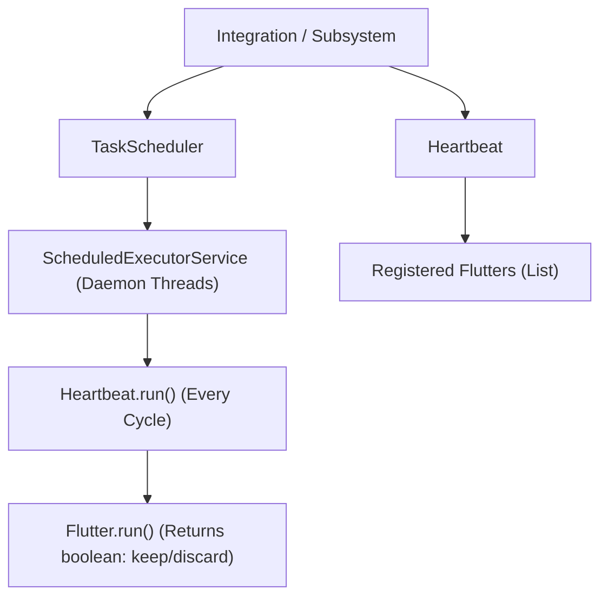

# Heartbeat & Task Scheduling

To prevent uncoordinated thread creation across plugins, QUIPT provides a centralized **Heartbeat loop** and a thread-safe **TaskScheduler**.

## Architecture



---

## 1. The `Heartbeat` & `Flutter` Concept

A **`Flutter`** represents a single recurring task managed by the integration's `Heartbeat`. Rather than spawning individual executor threads for every timer, flutters are gathered into a single cooperative loop.

### Creating a Flutter

A class implements `live.qsmc.quipt.core.heartbeat.flutter.Flutter`:

```java
import live.qsmc.quipt.core.heartbeat.flutter.Flutter;

public class CacheCleanupFlutter implements Flutter {

    private long lastRun = 0;
    private static final long INTERVAL_MS = 60_000; // 1 minute

    @Override
    public boolean run() {
        long now = System.currentTimeMillis();
        if (now - lastRun >= INTERVAL_MS) {
            lastRun = now;
            performCleanup();
        }
        // Return true to keep running on next heartbeat cycle;
        // Return false to unregister and remove this flutter.
        return true;
    }

    private void performCleanup() {
        // Purge expired tokens or cache records
    }
}
```

### Registering with an Integration

```java
// Inside your QuiptIntegration:
heartbeat().flutter(new CacheCleanupFlutter());
```

---

## 2. Direct Task Scheduling via `TaskScheduler`

When an asynchronous or delayed single-execution task is required, use `TaskScheduler`:

### Scheduling an Async Task

```java
import live.qsmc.quipt.core.utils.TaskScheduler;
import java.util.concurrent.TimeUnit;

// Run immediately in background thread pool
TaskScheduler.scheduleAsyncTask(() -> {
    fetchRemoteData();
}, 0, TimeUnit.SECONDS);

// Run with a 10-second delay
TaskScheduler.scheduleAsyncTask(() -> {
    broadcastNotification();
}, 10, TimeUnit.SECONDS);
```

### Scheduling a Repeating Async Task

```java
TaskScheduler.scheduleRepeatingAsyncTask(() -> {
    syncMetrics();
}, 5, 30, TimeUnit.SECONDS);
```

---

## Thread Safety & Shutdown Behavior

- `TaskScheduler` uses a guarded executor pool where `scheduleAsyncTask` immediately rejects tasks if the server is in the process of shutting down.
- On shutdown, `Heartbeat.shutdown()` clears all pending flutters and `TaskScheduler.shutdown()` halts worker threads with a dual 5-second graceful and 2-second forced timeout.
