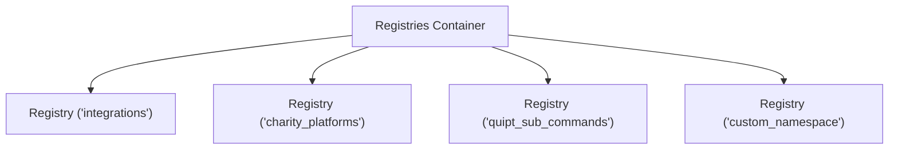

# Registries & Data Architecture

QUIPT centralizes dynamic object registration and data serialization through standard registry dictionaries and serialization utilities.

## Dynamic Registry System (`Registries` & `Registry<T>`)

The `Registries` class serves as a dictionary of registries, providing isolated namespaces for different object types.



### Basic Registry Usage

```java
import live.qsmc.quipt.core.Quipt;
import live.qsmc.quipt.core.data.registries.Registry;

// 1. Create or retrieve a registry
Registry<MyService> serviceRegistry = Quipt.INSTANCE.registries().register("services", () -> null);

// 2. Register an entry
serviceRegistry.register("auth_service", new MyAuthService());

// 3. Query an entry safely
serviceRegistry.get("auth_service").ifPresent(service -> {
    service.authenticate();
});

// 4. Iterate all registered entries
serviceRegistry.forEach((key, service) -> {
    System.out.println("Active service: " + key);
});
```

---

## Data Serialization (`JsonSerializable`)

Classes implementing `live.qsmc.quipt.core.data.JsonSerializable` define bidirectional conversion to and from `org.json.JSONObject`.

```java
import live.qsmc.quipt.core.data.JsonSerializable;
import org.json.JSONObject;

public class PlayerStatSnapshot implements JsonSerializable {
    public String uuid;
    public int score;

    @Override
    public JSONObject json() {
        JSONObject obj = new JSONObject();
        obj.put("uuid", uuid);
        obj.put("score", score);
        return obj;
    }

    public static PlayerStatSnapshot fromJson(JSONObject json) {
        PlayerStatSnapshot snapshot = new PlayerStatSnapshot();
        snapshot.uuid = json.getString("uuid");
        snapshot.score = json.getInt("score");
        return snapshot;
    }
}
```

---

## Data Pagination (`Pagifier` & `PageResult`)

When displaying large datasets to players or administrators (such as command lists or audit logs), `Pagifier<T>` handles indexing, sub-listing, and page-boundary calculations:

```java
import live.qsmc.quipt.core.data.Pagifier;
import live.qsmc.quipt.core.data.PageResult;
import java.util.List;

List<String> entries = List.of("Item A", "Item B", "Item C", "Item D", "Item E");

// Create pagifier with 2 items per page
Pagifier<String> pagifier = new Pagifier<>(entries, 2);

// Retrieve Page 1 (1-indexed)
PageResult<String> page1 = pagifier.page(1);

System.out.println("Page " + page1.page() + " of " + pagifier.maxPages());
for (String item : page1.items()) {
    System.out.println("- " + item);
}
```

---

## Metadata Container (`Metadata`)

`Metadata` provides a thread-safe, key-value storage container for transient runtime state attached to objects.

```java
import live.qsmc.quipt.core.data.Metadata;

Metadata meta = new Metadata();
meta.set("last_teleport", System.currentTimeMillis());
meta.set("invulnerable", true);

long lastTp = meta.get("last_teleport", Long.class, 0L);
```
