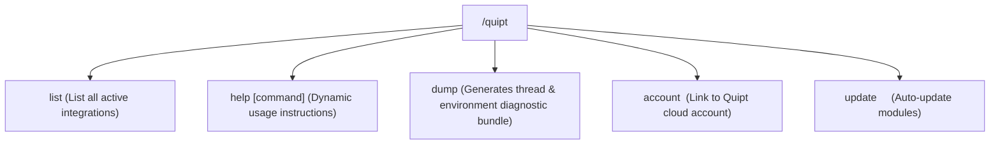

# Unified Command Framework

QUIPT provides a unified, cross-platform command framework that maps standard **Mojang Brigadier** command trees directly onto Paper, Fabric, and Velocity.

## Command Hierarchy (`/quipt`)

The main `/quipt` command provides an extensible subcommand registry:

---

## Command Reference

### 1. `/quipt`
- **`/quipt list`**: Lists all active modules, integrations, and registered plugins.
- **`/quipt help [subcommand]`**: Displays interactive, clickable help components.
- **`/quipt dump`**: Gathers full thread state, memory statistics, active plugins, and generates a downloadable report link.
- **`/quipt account register <username> <password> <email>`**: Initiates Quipt cloud account registration.
- **`/quipt account link <username> <password>`**: Links this server instance to your Quipt account.
- **`/quipt account token <access_token>`**: Authenticates via scoped API token.
- **`/quipt update <repo> <group> <name> <version>`**: Checks Maven repositories (`repo.qsmc.live`) and performs automated hot-patching.

### 2. `/webhook`
- **`/webhook add <id> <token> <channel>`**: Configures and persists a Discord webhook target.
- **`/webhook remove <id>`**: Removes a configured webhook target.

### 3. `/party`
- **`/party create <name>`**: Creates a new social group.
- **`/party join <name>`**: Joins an existing party (leaving previous party automatically).
- **`/party leave`**: Leaves current party.

### 4. `/sudo`
- **`/sudo <player> <command...>`**: Forces a player to execute a command string with their permissions.
