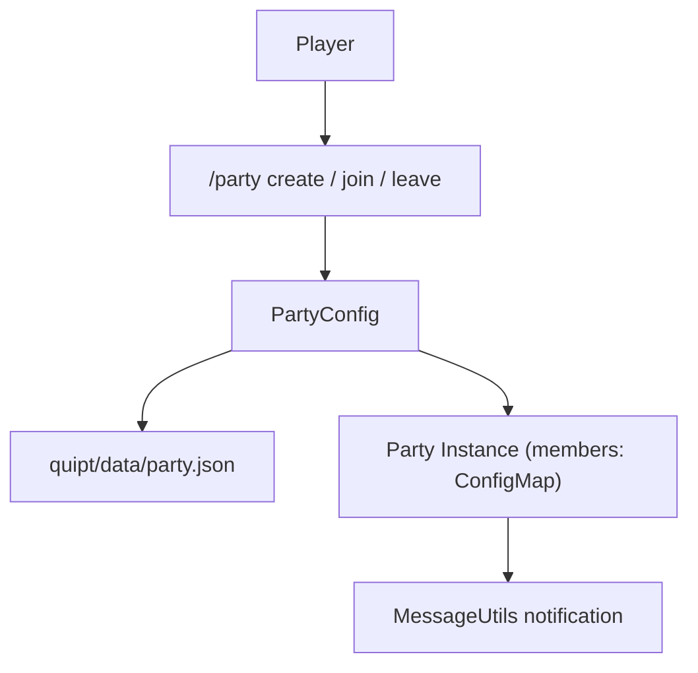

# Party & Social Management

QUIPT includes a built-in **Party Framework** (`Party` and `PartyConfig`) that facilitates cooperative gameplay, shared team channels, and group teleportation.

## Architecture & Lifecycle



---

## Configuration (`party.json`)

Parties and their constituent player UUIDs are automatically saved in `quipt/data/party.json`:

```json title="quipt/data/party.json"
{
  "parties": {
    "DragonSlayers": {
      "id": "DragonSlayers",
      "members": {
        "069a79f4-44e9-4726-a5be-fca90e38aaf5": {
          "id": "069a79f4-44e9-4726-a5be-fca90e38aaf5"
        }
      }
    }
  }
}
```

---

## Programmatic Party API

Developers can interact with the party manager directly:

```java
import live.qsmc.quipt.minecraft.api.MinecraftIntegration;
import live.qsmc.quipt.minecraft.api.MinecraftPlayer;
import live.qsmc.quipt.minecraft.config.files.PartyConfig;
import live.qsmc.quipt.minecraft.events.party.Party;
import java.util.Optional;

MinecraftIntegration<?,?> integration = getMinecraftIntegration();
PartyConfig partyConfig = integration.parties();

// Create or get party
Party party = partyConfig.create("RaidTeamAlpha");

// Add player to party (leaves prior party automatically)
party.join(player);

// Check membership
Optional<Party> activeParty = partyConfig.get(player);
activeParty.ifPresent(p -> {
    System.out.println("Player is in party: " + p.id());
});

// Remove player
party.leave(player);
```
