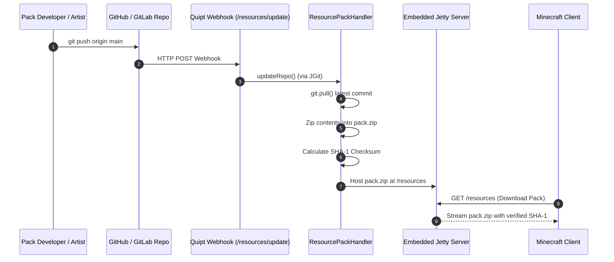

# Git Resource Pack Management & Server

QUIPT includes an automated **Resource Pack Management Engine** (`ResourcePackHandler`). Server owners maintain their resource pack in a Git repository (GitHub, GitLab, Gitea). QUIPT automatically pulls the latest changes, builds the `.zip` archive, generates a SHA-1 checksum, and serves it over HTTP to connecting players.

## Complete Workflow



---

## Configuration (`resources.qpt` / `resources.json`)

Resource pack settings are stored in `quipt/data/resources.qpt` (or `resources.json`):

```properties title="quipt/data/resources.qpt"
repo_url=https://github.com/YourOrg/ServerResourcePack.git
repo_branch=main
enabled=true

# Optional authentication for private repositories
auth.isPrivate=false
auth.username=git_user
auth.password=git_token_or_password

# Internal checksum cache (auto-generated)
hashes.encrypted_zip_hash=a1b2c3d4e5f6...
hashes.commit_hash=9f8e7d6c...
```

---

## Setting Up Automatic Webhooks

To have your server update its pack instantly when you push to GitHub or GitLab:

1. In your Git repository, navigate to **Settings > Webhooks > Add Webhook**.
2. Set the **Payload URL** to:
   ```text
   http://<YOUR_SERVER_IP>:5252/resources/update
   ```
3. Set the **Content type** to `application/json`.
4. Trigger on **Just the push event**.

---

## Manual In-Game Commands

Administrators can force an immediate sync from within Minecraft:

```bash
# Trigger an immediate git pull and zip rebuild
/resourcepack update
```
