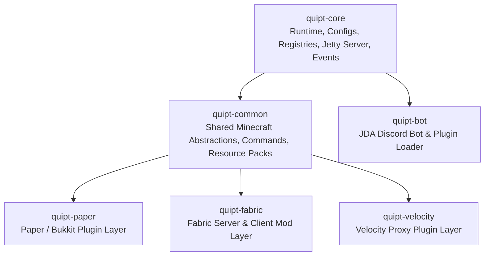

# Welcome to QUIPT

**QUIPT** is a multi-module runtime framework, server enhancement suite, and developer toolkit engineered for modern Minecraft networks and developers. Designed from the ground up for high reliability, minimal overhead, and cross-platform flexibility, QUIPT bridges the gap between Minecraft servers (Paper, Fabric), proxy networks (Velocity), embedded web services, and Discord communication.

---

## Core Value & Key Capabilities

QUIPT delivers a comprehensive suite of utilities that maximize operational efficiency for server owners and streamline development for programmers:

### 1. Platform-Agnostic Core Runtime
- **Modular Integration Lifecycle**: Centralized initialization and safe, multi-threaded shutdown coordination preventing orphaned background threads.
- **Dynamic Configuration Engine**: Reflection-driven, type-safe configuration system supporting JSON, YAML, TOML, and QPT formats with automated schema synchronization.
- **Embedded Web Server (Jetty)**: In-process HTTP/HTTPS servlet container for webhooks, health checks, and dynamic asset hosting without requiring external web servers.
- **Asynchronous Event Bus**: Decoupled, cancellable, prioritized event dispatching across modules.
- **Centralized Registries**: Type-safe registration and discovery mechanism for integrations, commands, charity platforms, and custom data types.

### 2. Minecraft Ecosystem Enhancements
- **Paper & Fabric Parity**: Unified command registration, player models, and messaging across Paper and Fabric server platforms.
- **Velocity Proxy Support**: Cross-network coordination and command execution at the proxy tier.
- **Git-Integrated Resource Pack Server**: Automated cloning, pulling, SHA-1 checksumming, compression, and HTTP distribution of server resource packs triggered via VCS webhooks or in-game commands.
- **Brigadier Command System**: Unified, cross-platform command framework with fluent argument builders, permission handling, and dynamic auto-completions.
- **Advanced Text & Messaging Utilities**: Adventure-backed message formatting, serializable tokens, and runtime placeholder substitution.
- **Party & Social Framework**: Persistent, serializable grouping system for multiplayer networks.

### 3. Discord & External Integrations
- **Standalone & Embedded Discord Bot**: Built on JDA with a dynamic runtime plugin system (`BotPluginLoader`) for modular bot extensions.
- **Discord Webhook Manager**: Thread-safe webhook dispatch with fluent `Embed` builders, automatic batching, and error recovery.
- **Charity Campaign Tracking**: Real-time polling and synchronization for charity fundraising platforms (ExtraLife and Tiltify) with ETag caching and pagination support.

---

## Multi-Module Breakdown

| Module | Target Environment | Primary Responsibilities |
| :--- | :--- | :--- |
| **`modules/core`** | Platform Agnostic | Base integration lifecycle, configuration manager, embedded Jetty server, task scheduler, heartbeat, registries, event system, charity integrations, Discord webhooks. |
| **`modules/common`** | Minecraft Shared | Shared Minecraft models (`MinecraftPlayer`, `Location`), Brigadier command abstractions, `ResourcePackHandler`, chat and placeholder utilities, `Party` system. |
| **`modules/paper`** | Paper / Purpur / Bukkit | Paper plugin entrypoint (`QuiptPaper`), `PaperPlayers` management, `VoidChunkGenerator`, Bukkit command execution bridge. |
| **`modules/fabric`** | Fabric (Server / Client) | Fabric mod entrypoint (`QuiptFabric`), lifecycle listeners, block/item registry hooks, particle systems, client datagen, plugin messaging. |
| **`modules/velocity`** | Velocity Proxy | Velocity proxy plugin (`QuiptVelocity`), proxy command bridges, network-level coordination. |
| **`modules/bot`** | Discord Runtime | Standalone Discord bot application (`QuiptBot`), JDA wrapper (`QDA`), dynamic `BotPluginLoader`. |

---

## Next Steps

To begin using or developing with QUIPT, explore the following sections:

- [System Architecture](architecture.md) — Comprehensive technical overview of module boundaries and execution flow.
- [Installation Guide](installation.md) — Setup instructions for Paper, Fabric, Velocity, and Discord Bot.
- [Core Runtime & Lifecycle](core/lifecycle-and-runtime.md) — Deep dive into the initialization and shutdown architecture.
- [Configuration Reference](core/configuration-system.md) — Detailed specifications for all configuration files.
- [Developer Guide](developer/api-reference.md) — API reference, extension patterns, and practical code examples.
