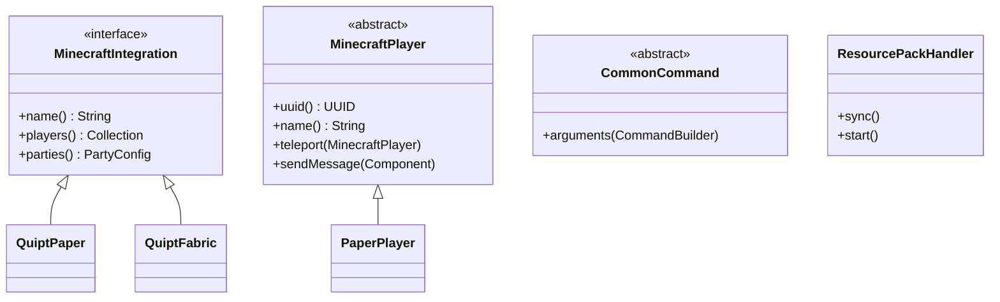

# Common Minecraft Module (`quipt-common`)

The `quipt-common` module defines the shared Minecraft API layer implemented by `quipt-paper`, `quipt-fabric`, and `quipt-velocity`.

## Core Abstractions

---

## Key Components

### 1. `MinecraftIntegration<T, K>`
Generic interface implemented by platform entrypoints. Handles platform-specific namespaced keys, data directories, and server listeners.

### 2. `MinecraftPlayer`
Unified player representation providing:
- UUID querying and validation.
- Cross-platform message dispatch using Adventure Components.
- Peer-to-peer teleportation (`player.teleport(target)`).

### 3. `Location` & `ConfigLocation`
Cross-platform 3D coordinate model with yaw/pitch and world identifiers. Serializes seamlessly to and from JSON configuration files via `ConfigLocationFactory`.

### 4. `CommandBuilder<S>`
Abstraction layer bridging platform command dispatchers (Bukkit, Fabric, Velocity) into standard Mojang Brigadier argument trees.
