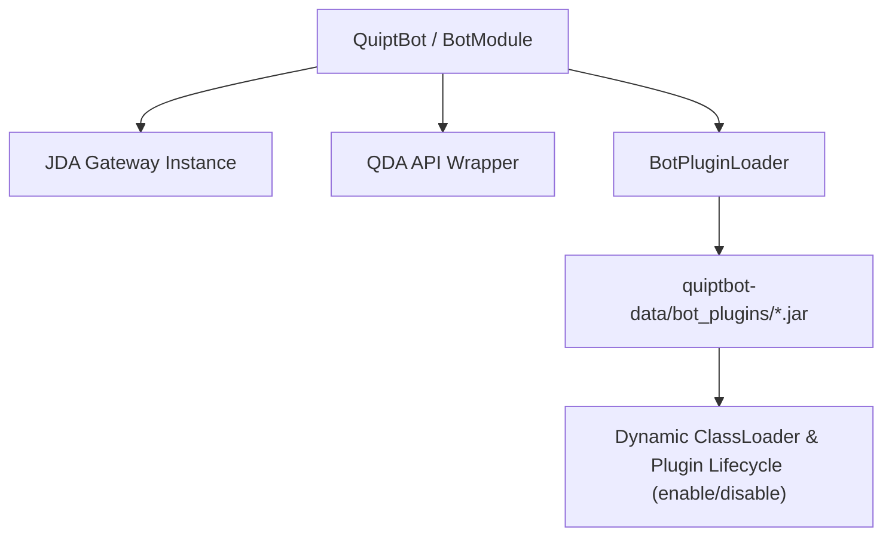

# Discord Bot Module (`quipt-bot`)

The `quipt-bot` module provides a Discord bot integration built on **JDA 5 (Java Discord API)**. It can operate either standalone as a daemon or embedded inside a Minecraft server plugin.

## Bot Architecture



---

## 1. Bot Lifecycle & Initialization

`BotModule` manages the JDA connection and loads configuration from `BotConfig.json`:

```java
package live.qsmc.quipt.discord;

public abstract class BotModule extends QuiptIntegration {
    public JDA jda();
    public QDA qda();
    public BotPluginLoader plugins();
}
```

### Configuration (`BotConfig.json`)

```json title="quiptbot-data/BotConfig.json"
{
  "token": "YOUR_DISCORD_BOT_TOKEN"
}
```

---

## 2. The `QDA` Abstraction Layer

`QDA` wraps raw JDA models with developer-friendly helper classes:
- **`QuiptGuild`**: Guild metadata, member queries, role validation.
- **`QuiptTextChannel`**: Fluent message sending, embed posting, and history retrieval.
- **`QuiptMessage`**: Message manipulation, replies, and reaction management.
- **`QuiptUser`**: User profile queries and avatar resolution.

---

## 3. Dynamic Plugin System (`BotPluginLoader` & `BotPlugin`)

QUIPT bot supports runtime modularity: you can add or update features without restarting the bot.

### How Bot Plugins Work:
1. `BotPluginLoader` scans `quiptbot-data/bot_plugins/` on startup.
2. For each `.jar` found, it opens `bot.plugin.properties` inside the JAR.
3. It loads the `main` class via an isolated `URLClassLoader`.
4. The plugin's `enable()` method is executed.

### Plugin Manifest (`bot.plugin.properties`)

```properties title="src/main/resources/bot.plugin.properties"
name=TicketSystem
main=com.example.bot.TicketPlugin
version=1.0.0
```

### Example Bot Plugin Implementation

```java
package com.example.bot;

import live.qsmc.quipt.discord.plugins.BotPlugin;
import live.qsmc.quipt.discord.plugins.BotPluginLoader;

public class TicketPlugin extends BotPlugin {

    public TicketPlugin(BotPluginLoader pluginLoader) {
        super(pluginLoader);
    }

    @Override
    public String version() {
        return "1.0.0";
    }

    @Override
    public java.io.File folder() {
        return new java.io.File(bot().folder(), "plugins/tickets");
    }

    @Override
    public void enable() {
        logger().log("Tickets", "Ticket plugin enabled!");
        // Hook into events or register slash commands
    }

    @Override
    public void disable() {
        logger().log("Tickets", "Ticket plugin disabled.");
    }
}
```
